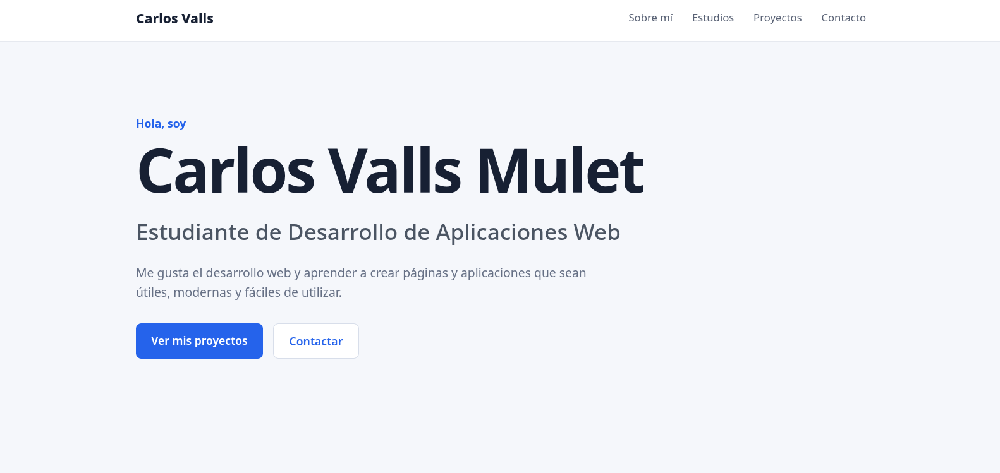

# Portfolio de Carlos Valls Mulet

## 1. Descripción

Portfolio personal de Carlos Valls Mulet, estudiante de Desarrollo de Aplicaciones Web (DAW). En él se muestra información sobre mí, mis proyectos y mis conocimientos de desarrollo web.

## 2. Web publicada

## 3. Captura de pantalla

## 4. Arquitectura y tecnologías

El proyecto está desarrollado utilizando las siguientes tecnologías y herramientas:

- **HTML5:** estructura y contenido de la página.
- **CSS3:** diseño visual y estilos.
- **JavaScript:** funcionalidades interactivas, si están implementadas.
- **Git y GitHub:** control de versiones y gestión del código.
- **GitHub Actions:** automatización de las comprobaciones de calidad.
- **Prettier:** comprobación del formato del código.
- **HTML-Validate:** validación del marcado HTML.
- **Lychee:** comprobación de los enlaces.

## 5. Procedimiento de despliegue

El código se gestiona mediante Git y GitHub, utilizando ramas y pull requests para incorporar los cambios a la rama principal `main`.

Las pull requests permiten revisar las modificaciones y comprobar que superan las validaciones automáticas antes de fusionarlas. El despliegue de la web se realiza mediante el sistema configurado en el repositorio.

## 6. Validaciones del pipeline

El proyecto cuenta con cuatro comprobaciones automatizadas mediante GitHub Actions:

- **HTML:** comprueba que el marcado HTML cumple las reglas de validación.
- **Enlaces:** verifica que los enlaces de la web se puedan resolver.
- **Formato:** comprueba que el código mantiene el formato establecido con Prettier.
- **Lighthouse:** evalúa la calidad de la web, incluyendo la accesibilidad, el rendimiento y las buenas prácticas.

Estas comprobaciones ayudan a detectar errores y mantener la calidad del proyecto antes de integrar los cambios.
